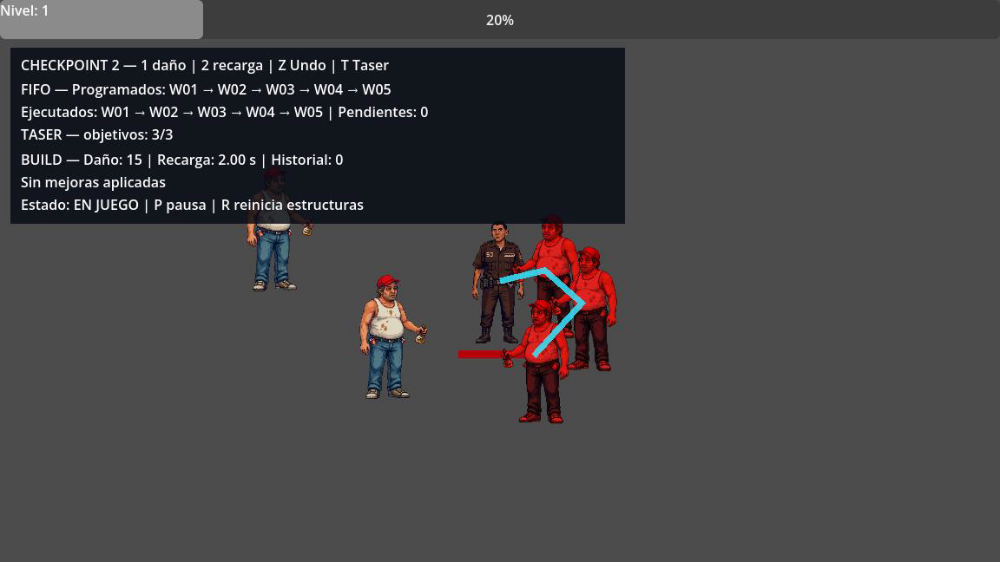

# Want a Soda? Amado y peligroso

**Estado:** en desarrollo. Copia de portafolio de Javier Guzmán basada en la última versión integrada de `main` del [repositorio del equipo](https://github.com/RobertoJVE/want-a-soda), commit `369e189101a8f0b32477bf453ceb4445561dec2a` del 11 de octubre de 2026 (hora de El Salvador).

## Participación y créditos

Proyecto académico de equipo. Mi área de trabajo es algoritmos y sistemas de gameplay: pilas, colas y módulos algorítmicos, con pruebas para verificar su comportamiento. El alcance y la distribución de trabajo se documentan en [mi rol](docs/roles/JAVIER_GUZMAN.md) y en [el resumen del Checkpoint 2](docs/JAVIER_CHECKPOINT2.md).

El equipo está formado por Guillermo Córdova, René Serrano, Carlos Valencia, Javier Guzmán y Roberto Villacorta. Las responsabilidades compartidas y la integración de esta versión se detallan más abajo. Esta copia conserva los créditos del proyecto original.



Vertical slice jugable en Godot 4.7 para demostrar estructuras de datos y recursión en el Checkpoint 2.

En el Checkpoint 1, el inventario se modeló con listas en Python como entrega académica. Para el Checkpoint 2, con aprobación del docente, el equipo pasó a demostrar pilas, colas y recursividad dentro del juego en Godot/GDScript mediante Undo de mejoras, oleadas y el Taser. El juego actual se ejecuta en Godot; el código Python corresponde a la entrega anterior.

## Historia y concepto

La historia ocurre de noche en una colonia salvadoreña y toma el humor negro del meme «¿Querés gaseosa?». Amado Neftalí, un vigilante nocturno, protege a los vecinos de fiesteros, borrachos y otros peligros que van aumentando de dificultad. Al final lo espera el CIO de Salva Cola, que le ofrece una gaseosa. Amado quiere derrotarlo para liberar a la colonia y a sí mismo de esa amenaza.

El juego se plantea como una supervivencia 2D vista desde arriba: Amado se mueve por la colonia mientras enfrenta oleadas, recoge monedas de experiencia y mejora su equipo. La Escopeta es su arma inicial y distintiva. El concepto original incluye armas como el Taser, el Garrafón de Agua, la Caña Rica y el Machete; pasivos como las Botas de vigilante y el Chaleco antibalas; y la Regia Chola como curación encontrada en el mundo. El inventario previsto admite hasta cinco armas y cinco pasivos.

Esta versión de Checkpoint 2 demuestra movimiento, Escopeta, un tipo de enemigo, XP con elección de mejoras, cola de oleadas, Undo de mejoras y Taser recursivo. El inventario equipable, los demás enemigos y el CIO pertenecen al concepto y todavía no forman parte de la escena jugable. El diseño ampliado está en la [biblia del juego](docs/GAME_BIBLE.md).

## Abrir y ejecutar

Versión verificada: **Godot 4.7.2 stable**, renderer GL Compatibility.

1. En el Project Manager de Godot, pulsa **Import** y selecciona `project.godot`.
2. En el editor, pulsa **F5**. La escena principal configurada es `mundo.tscn`.

Controles:

- Flechas: mover a Amado.
- Derrota enemigos, recoge los centavos (1 XP cada uno) y, al subir de nivel, elige una de las tres mejoras del menú. Las ofertas cambian daño, recarga o velocidad reales.
- En el menú de nivel, **Deshacer mejora anterior** restaura el último cambio de build (LIFO); no devuelve XP ni niveles.
- `1`, `2` y `Z`: atajos de demostración para daño, recarga y Undo. Estos atajos todavía permiten probar mejoras sin gastar XP.
- `T`: disparar el Taser inmediatamente; también se activa cada `2.5 s`.
- `P`: pausar/reanudar. La cola, Taser, enemigos y disparos quedan pausados.
- Con el menú de nivel abierto, `P` no lo cierra: hay que completar las elecciones pendientes. `R` puede reiniciar la partida.
- `R`: reiniciar la escena. Cola e historial nacen limpios y reproducibles.

El panel superior muestra el orden programado/ejecutado de la cola, objetivos del Taser, build actual (incluida velocidad), tamaño del historial y estado de pausa. El XP sobrante se conserva, una ganancia puede subir varios niveles y el máximo es 20.

## Pruebas reproducibles

Desde la raíz del repositorio en PowerShell:

```powershell
godot --headless --editor --path . --quit
godot --headless --path . --script tests/algorithms/test_runner.gd
godot --headless --path . --script tests/checkpoint2/test_runner_checkpoint2.gd
godot --headless --path . --script tests/checkpoint2/test_xp_menu.gd
godot --headless --path . --script tests/checkpoint2/test_wave_schedule.gd
godot --headless --path . --quit-after 360
```

La primera orden registra los `class_name` en la caché de importación local. Los runners cubren, respectivamente, **25**, **28**, **29** y **14** assertions (96 en total): estructuras aisladas; integración de oleadas/Undo/Taser (incluidos 0, 1, 3 y 8 objetivos, profundidad y objetivo final); XP/menú; y tiempo, empates, pausa, límite de spawns y capacidad de la cola. La última orden es una prueba de apertura de la escena. Resultados, trazas seleccionadas y capturas de las versiones verificadas: [evidencia de ejecución](docs/evidence/checkpoint2_validation_2026-10-11.md).

## Correspondencia académica

- **Cola FIFO:** `WaveManager` programa W01–W05 por tiempo y secuencia. W02 y W03 empatan en tiempo y mantienen su orden; W03 muestra un aviso además de generar un enemigo. El reloj se detiene con la pausa. Un salto de tiempo genera como máximo cinco enemigos por frame y nunca supera 50 enemigos activos: lo pendiente queda al frente de la cola. El HUD muestra el siguiente evento y el último efecto. `enqueue` y `dequeue` cuestan O(1) amortizado; crecer el buffer cuesta O(n).
- **Pila LIFO:** antes de cada mejora real se guarda una copia profunda del daño, la recarga y la velocidad. `peek` consulta y `pop` restaura el último build. Push/pop son O(1) amortizado, más O(b) por copiar el build.
- **Recursión:** `_encadenar_recursivo` aplica daño al objetivo actual y se llama con el vecino no visitado y `restantes - 1`. Los casos base son: límite alcanzado, objetivo nulo/liberado o ya visitado. Dos análisis adaptados son calcular la profundidad real alcanzada y señalar el objetivo más profundo (ID consultable y anillo visual); también se registra el motivo del corte. Para E enemigos y K impactos (inicia en 3; límite duro `K <= 8`), la búsqueda actual cuesta O(K·E) tiempo y O(K) espacio de pila/visitados.
- **Pausa/reinicio:** pausar congela el árbol sin vaciar estructuras; reanudar continúa el mismo orden. Reiniciar recrea la escena y, por decisión explícita, vacía cola e historial.

### Fragmentos y decisiones técnicas

- El cambio de build guarda primero el estado anterior: `historial_build.push(obtener_build())`; Undo usa `historial_build.pop()` y restaura daño, recarga y velocidad. `peek()` consulta la última entrada sin sacarla. La pila limita el historial a 64 snapshots; al superar ese límite elimina el más antiguo en O(H), con H ≤ 64.
- El plan de oleadas se valida en orden `(time_s, sequence)`. `_cola.peek()` mantiene el evento al frente hasta que llega su tiempo y hay jugador/capacidad; `_cola.dequeue()` se llama solo cuando termina. `procesar_eventos_pendientes()` procesa hasta cinco spawns por frame y `contar_eventos_de_tipo()` consulta sin consumir la cola.
- El Taser encuentra el primer enemigo válido y llama `_encadenar_recursivo(..., restantes - 1, profundidad + 1)` para cada salto. Termina con cero restantes, objetivo inválido/visitado o sin vecino elegible. El diccionario de visitados se crea en cada descarga, evitando repetición dentro de la cadena sin impedir descargas posteriores.
- Un Undo **no** devuelve eventos a la cola: revierte solo el build. Pausar conserva tanto cola como historial; reiniciar la escena comienza ambos de nuevo. Estas decisiones evitan fingir un sistema de movimientos por salas que este juego no tiene.

### Alcance de la adaptación aprobada

El curso autorizó usar **Undo de build**, **oleadas FIFO** y **Taser recursivo** en lugar de la pila de movimientos, los turnos por salas y la mazmorra recursiva del enunciado Python. Para este Checkpoint 2 no se entrega Python ni se afirma que esta versión tenga salas, árbol de mazmorra, turnos rotatorios o inventario equipable. La cola aporta dos operaciones adaptadas (`procesar_eventos_pendientes` y `contar_eventos_de_tipo`); el Taser adapta el cálculo de profundidad real y la marca del objetivo más profundo. La pila implementa `push`, `pop` y `peek`, pero no dos funciones adicionales de la Guía 5. Si la aprobación del profesor no cubre también esos detalles auxiliares, siguen siendo diferencias frente a la rúbrica original.

## Alcance y responsabilidades asumidas

René Serrano mantiene enemigos, oleadas e integración de gameplay. Para desbloquear la entrega con el equipo ausente se hicieron cambios pequeños adicionales en áreas compartidas:

- Gameplay/Guillermo: stats reales de bala/recarga/velocidad en `jugador(amado_neftali).gd`, menú visual basado en su rama `Guille`, panel en `hud.tscn`, escena principal e integración en `mundo.tscn`.
- XP/arquitectura/Carlos: ganancia acumulada de XP, varias elecciones pendientes, nivel máximo y conexión del menú con la pila del build.
- Algoritmos/Javier: clases Queue/Stack, Taser recursivo con límite duro de ocho y pruebas integradas; se añadió `snapshot()` a Queue para consultar eventos sin consumirlos.
- QA/documentación/Roberto: planificación y evidencia inicial; René/Codex actualizaron este README, runners y la evidencia de validación para la entrega, sin modificar los paquetes ya entregados bajo `docs/checkpoints/`.

## Limitaciones conocidas

- La derrota todavía solo se informa por consola; no hay pantalla de Game Over.
- Los atajos `1`/`2`/`Z` siguen siendo una vía de demostración que no requiere XP. Falta decidir si se eliminan o se restringen a un modo de pruebas.
- El botón Undo del menú está disponible al subir de nivel; fuera de ese momento se usa el atajo `Z`.
- Se reutiliza un solo tipo de enemigo y el arte existente.
- El HUD muestra el tamaño del historial y el último cambio, no una lista completa de acciones. No hay sistema de turnos con tres participantes, árbol de salas ni inventario equipable en esta escena.
- No se incluye ejecutable exportado ni plantillas de exportación.

La primera evidencia de gameplay quedó en `main` tras los PR #15, #17, #18 y #19 (merge SHA `2fbe39a164138776bd70f49586d13971a1f6ebe1`). La mejora de profundidad recursiva es posterior a ese corte y se documenta por separado en la evidencia.
