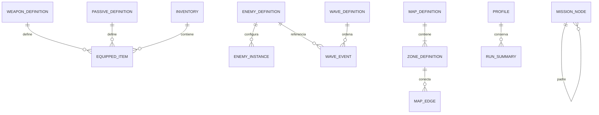

# Arquitectura de datos y persistencia local

**Dueño: Carlos · Consumidores: todos.** La «base de datos» del proyecto es un catálogo local de definiciones con IDs estables, estado de partida en memoria y un perfil JSON versionado. No se necesita servidor, login, ORM ni SQL para este juego de un jugador. Si la rúbrica exige expresamente una base relacional, se registra como nuevo requisito; no hay evidencia de ese requisito en las fuentes disponibles.

## Tres capas y una sola autoridad

| Capa | Formato/ruta prevista | Contenido | Escritura |
|---|---|---|---|
| Definiciones | Resources `.tres` en `res://data/` | Armas, pasivos, enemigos, oleadas, zonas, misiones | Roberto edita valores; Carlos mantiene esquema; revisión del consumidor |
| Runtime | Objetos/arrays/diccionarios nuevos por run | Vida, XP, inventario, cola, flags, enemigos, misiones | Cada sistema dueño indicado en arquitectura |
| Perfil | `user://profile_v1.json` | Configuración, misiones históricas, últimos 20 resúmenes | ProfileStore después de validar |
| Evidencia | `docs/metrics/` y `docs/checkpoints/` | Datos de medición, videos, tablas y reportes | Roberto; cada integrante aporta su módulo |

Los Resources son contenedores editables en el Inspector y pueden ser compartidos entre instancias. Por eso las definiciones se tratan como inmutables al iniciar; HP y nivel equipado viven en objetos runtime separados. [Documentación de Resources](https://docs.godotengine.org/en/stable/tutorials/scripting/resources.html).

Los [JSON de ejemplo](data_examples/README.md) son fixtures de diseño del contrato. No son un segundo catálogo de balance de producción. Tras implementar Resources, `.tres` es la autoridad del contenido; los fixtures se actualizan solo para mantener ejemplos coherentes.

## Relaciones lógicas

Un EquippedItem apunta **a un arma o a un pasivo**, nunca a ambos. El diagrama representa las dos variantes, no una doble pertenencia. Las relaciones se validan en carga; no hay claves foráneas de SQL. MapEdge referencia dos zonas del mismo mapa. MissionNode tiene a lo sumo un padre; no se admiten ciclos ni referencias externas.

## IDs y versiones

IDs ASCII `snake_case`, separados del texto visible. `shotgun` sigue siendo el mismo ID aunque se cambie «Escopeta». No usar nombre traducido como llave. Los IDs se mantienen únicos entre armas/pasivos/pickups; nombres visibles pueden repetirse sin afectar lookup.

`schema_version` versiona el formato del perfil; `balance_version` identifica valores usados por una partida. `run_id` identifica la partida; `enemy_instance_id` diferencia enemigos del mismo tipo. Un recurso no guarda `current_level`, HP actual ni referencias a enemigos vivos.

DataCatalog crea diccionarios por ID para runtime y una lista ordenada por ID para la búsqueda binaria académica. La búsqueda UI devuelve la misma definición que el diccionario. No se ordena de nuevo en cada consulta.

## Validación al iniciar

1. Leer definiciones y tipos; rechazar números no finitos, daño negativo, cooldown ≤0, HP ≤0 y niveles vacíos.
2. Verificar IDs únicos, referencias de escenas y categorías permitidas.
3. Verificar un máximo de cinco niveles por equipable y coherencia de sus parámetros.
4. Verificar oleadas ordenadas por `(time_s, sequence)`, cantidades positivas y enemigos conocidos; CIO una vez a 300 s, mini jefe una vez a 180 s.
5. Verificar zonas/aristas y reachability por DFS; mostrar zonas faltantes y bloquear ese mapa si la ruta obligatoria no existe.
6. Verificar raíz única de misiones, padres existentes, ausencia de ciclos y condición/recompensa válidas.
7. Generar índices y registrar versión del catálogo. Error legible: archivo, campo, valor y regla incumplida. No iniciar una partida parcial.

Se valida **antes de instanciar** enemigos o consumir guardados. Roberto puede editar daño/HP; cambios de tipo, campo o significado requieren revisión de Carlos y consumidores.

## Reglas de estado mutable

`InventoryState` contiene dos arrays pequeños de EquippedItem, revisión y run_id. Snapshots incluyen copias de arrays/diccionarios; nunca Nodes. Modificar un snapshot externo no debe modificar la partida.

`PlayerState` es una vista compuesta de Health/XP/Stats, no un objeto adicional con autoridad sobre sus campos. `WorldState` contiene solo flags/zonas/mapa propios. Guardar referencias `Node`, `Callable`, Tween o Resource de escena en JSON está prohibido por contrato; convertir a primitivas e IDs.

## Persistencia y recuperación

Guardar opciones al confirmar y resumen al cerrar una partida. No guardar por frame ni suspender/reanudar una run en MVP. La ruta `user://` y serialización JSON se apoyan en [Saving games de Godot](https://docs.godotengine.org/en/stable/tutorials/io/saving_games.html); el protocolo siguiente es diseño propio del proyecto.

1. Construir payload primitivo validado y limitar historial a 20 runs; evitar `run_id` duplicados.
2. Serializar a `profile_v1.tmp`, cerrar y volver a leer/validar.
3. Conservar el último perfil válido como `.bak`; reemplazar archivo principal mediante operación de rename comprobada.
4. Solo informar éxito después del reemplazo. Si falla, conservar archivo anterior y avisar «No se pudo guardar»; permitir seguir jugando.
5. Al cargar: ausente → perfil por defecto; principal inválido → probar backup; ambos inválidos → conservar copia `.corrupt` y usar defaults con aviso.
6. Versión futura desconocida → no sobrescribir; jugar con perfil temporal. Una migración de versión antigua opera en copia y se prueba antes de guardar.

No se promete atomicidad universal entre sistemas de archivos. Se prueba interrupción entre pasos y se mantiene backup. Un guardado editado por el usuario no otorga acceso a servicios externos; aun así se validan límites e IDs para evitar crashes.

## Guardado inicial

- Volumen master entre 0 y 1, reduce_flashes booleano, controles permitidos.
- `completed_mission_ids`: historial, filtrado por catálogo actual con advertencia por IDs retirados.
- `recent_runs`: resultado, seed, versión de balance, tiempo, nivel, bajas y build.
- Sin datos personales, rutas absolutas de la máquina, credenciales ni telemetría remota.

## Migración de datos anteriores

El Python de CP1 usa nombres y permite repetidos/consumir armas. Se conserva como evidencia académica y se portan las validaciones de capacidad; la propuesta Godot usa ID único y upgrade. No importar automáticamente listas Python como partidas guardadas. La prueba de equivalencia cubre agregar, buscar, contar y límites; las diferencias de usar/soltar/reemplazar se documentan como cambio de diseño.

## Entregables de Carlos

Esquemas de [DATA_SCHEMA](DATA_SCHEMA.md), cargador validador, catálogo indexado, inventario transaccional, perfil local con recuperación y casos de prueba de datos inválidos. Roberto entrega valores y fixtures; cada consumer prueba que esos valores producen la conducta esperada. Ningún sistema queda «terminado» solo por existir un JSON.
