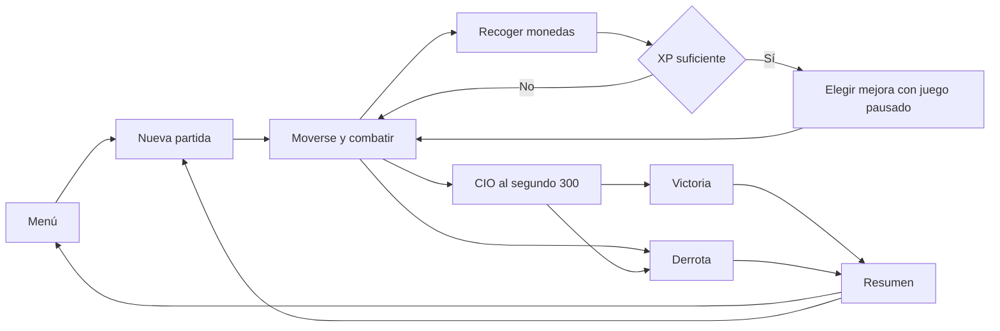

# Biblia de Want a Soda Amado y peligroso

**Dueño: Roberto · Revisión: equipo · Diseño propuesto v2.0.** La experiencia es sobrevivir una noche absurda en una colonia salvadoreña: moverse bien, recoger monedas y formar una combinación de armas y pasivos para enfrentar al CIO de Salva Cola. Se adopta el loop de supervivencia de Vampire Survivors con personajes, entorno y contenido propios del proyecto.

## Identidad y dirección

Amado Neftalí es un vigilante nocturno; su Escopeta es el punto de partida de todas las partidas. La colonia tiene muros, tienda, parqueo, callejón y un acceso de servicio de Salva Cola. El CIO aparece al final ofreciendo gaseosa. El humor se expresa en nombres, diálogos breves y situaciones caricaturescas; la legibilidad del combate tiene prioridad sobre los chistes.

La dirección visual conserva sprites y animaciones existentes: top-down 2D, siluetas claras y noche con suficiente contraste. Enemigos, monedas y ataques peligrosos necesitan formas además de colores. Evitar depender de destellos para comunicar daño; incluir opción de reducirlos. Audio corto para disparo, impacto, moneda, mejora y anuncio de jefe; registrar origen y permiso de uso de cada asset.

## Reglas de una partida

| Regla | Valor de la propuesta |
|---|---|
| Mapa | Una arena Colonia con seis zonas, sin pantallas de carga entre zonas |
| Movimiento | Flechas existentes; añadir WASD como acciones explícitas |
| Ataque | Automático; Escopeta apunta al enemigo válido más cercano |
| Pausa | Esc; la misma acción reanuda solo la pausa manual |
| Inicio | 100 HP, nivel 1, 0 XP, Escopeta L1, sin pasivos |
| Oleadas | 0–300 s de tiempo activo; mini jefe único a 180 s |
| Final | CIO único a 300 s; 90 s activos adicionales para vencerlo |
| Victoria | CIO derrotado y jugador vivo al resolver el frame |
| Derrota | Vida ≤0 o se agotan los 90 s del CIO |
| Inventario | Hasta 5 armas y 5 pasivos; un slot por ID único |
| Progresión | XP requerida en nivel n: `5 + 10*(n-1)`; máximo 20 |
| Curación | Regia Chola, pickup inmediato; nunca ocupa inventario |
| Guardado | Opciones, misiones completadas y resúmenes; sin continuar una partida a medias |

Si jugador y CIO mueren en el mismo frame, se resuelve derrota. A los 300 s cesan nuevos spawns regulares y se retiran enemigos regulares y mini jefe superviviente sin XP ni contarlos como bajas; se conservan monedas. Se reserva espacio para el CIO aunque el cupo de enemigos esté lleno. El cambio se anuncia visualmente. El plazo final empieza al crear al CIO correctamente.

## Loop y pantallas

Menú: jugar, opciones, salir. HUD: vida, barra/valor de XP, nivel, cronómetro, slots y anuncio del jefe. Mejora: de una a tres opciones válidas con nombre, efecto y nivel resultante; el clic elige y confirma. Pausa: reanudar, opciones y volver al menú. Resumen: resultado, tiempo activo, nivel, bajas, daño por arma y build; botones volver a jugar/menú. El menú académico debug muestra estructuras y permite escenarios de demo; se identifica como debug y no altera récords normales.

## Reglas de progresión

La muerte de un enemigo genera un pickup con XP 1, 5 o 20; solo recogerlo suma XP. Cada umbral resta su coste conservando sobrante. Un pickup grande puede otorgar varias subidas; cada subida genera una elección pendiente, resueltas una a una sin reanudar en medio.

Cada elección contiene IDs distintos. Un objeto ya equipado se ofrece como mejora, no como segunda copia. Si una categoría tiene cinco slots, se excluyen adquisiciones de esa categoría pero se permiten sus mejoras. No se ofrece un objeto en nivel máximo. Si quedan menos de tres opciones se muestran las disponibles. Si no queda ninguna, se ofrece «Recuperar 20 HP»; a vida máxima el botón dice «Continuar» y consume la elección. No hay re-roll ni reemplazo libre en el MVP.

Armas/pasivos llegan a L5. Subir de nivel de personaje no cura automáticamente ni aumenta daño por sí solo. Las mejoras elegidas producen esos efectos. En nivel 20 la XP adicional cuenta en estadísticas pero no abre elecciones y la barra muestra MAX. Los pasivos se recalculan desde valores base para evitar acumulación accidental.

## Contenido comprometido

| ID | Nombre visible | Conducta | Entrada |
|---|---|---|---|
| shotgun | Escopeta | Proyectil automático; conservar efecto visual actual, expandir cono solo tras estabilizarlo | Inicial |
| taser | Taser | Cadena recursiva limitada, sin repetir objetivo por descarga | CP2 |
| machete | Machete | Golpe periódico de área corta; un impacto por enemigo y ataque | MVP |
| boots | Botas de vigilante Timberland | Aumentan velocidad | CP2/MVP |
| vest | Chaleco antibalas | Reduce daño recibido con mínimo de 1 | MVP |
| rancheras | Rancheras / Corridos Tumbados | Aumentan frecuencia de ataque | MVP |
| regia_chola | Regia Chola | Cura 20 HP hasta el máximo | MVP |
| enemy_basic | Gordo Bolito | Persecución y contacto | Baseline adaptado |
| enemy_medium | Matón nocturno | Más vida, más daño, menor velocidad | MVP |
| miniboss | Encargado de la cuadra | Persecución + embestida telegrafiada | MVP |
| boss_cio | CIO de Salva Cola | Persecución lenta + ataque radial telegrafiado | MVP |

Los nombres adicionales y patrones del mini jefe son propuestas nuevas de este paquete. La segunda fase del CIO aumenta frecuencia al 50% HP, sin otra escena ni sistema de combate. Nunca aparece un patrón nuevo sin aviso previo.

Objetivo ampliado después de QA: `water_jug` (Garrafón de Agua, área al impacto), `cana_rica` (área persistente), `fas_scarf` (vida máxima), `raptor` (radio de recolección). Caña Rica queda como arma según el Word y Python actuales. Resortera, Capirucho y más mapas quedan opcionales.

## Grafo integrado sin multiplicar mapas

Seis regiones del mismo mapa: `entrada`, `parqueo`, `tienda`, `callejon`, `plaza`, `salva_cola`. Las conexiones representan pasos transitables reales. BFS dibuja una ruta hacia una Regia Chola disponible; si no hay pickup, hacia Salva Cola. DFS verifica que todas las zonas obligatorias sean alcanzables desde entrada. No sustituye el movimiento local ni requiere pathfinding por cada enemigo.

## Árbol de misiones

Un árbol pequeño durante la partida: `patrulla` raíz → `recoger_5_monedas` → `visitar_tienda` → `derrotar_miniboss`. Cada nodo tiene un único padre y una recompensa de curación o spawn de Regia una sola vez. Puede añadirse una rama hermana `visitar_parqueo`. Completar una misión activa a sus hijos. Las misiones se reinician en cada partida; el perfil guarda cuáles se completaron alguna vez para mostrar historial, sin alterar los valores iniciales del MVP.

## Sensación de juego y aceptación

El jugador recibe su primera elección idealmente entre 20 y 45 s, entiende qué lo golpeó y puede salir de una amenaza señalizada. No debe poder quedarse inmóvil toda la partida ni recibir spawns encima. Roberto prueba al menos cinco partidas con varias builds y documenta lo observado; estos objetivos son hipótesis de balance, no resultados actuales.

Se mantiene una partida normal corta y un escenario debug acelerado para defensa. La opción debug debe mostrar seed, tiempo simulado y efectos activados; no se ocultan atajos en una supuesta partida normal.
