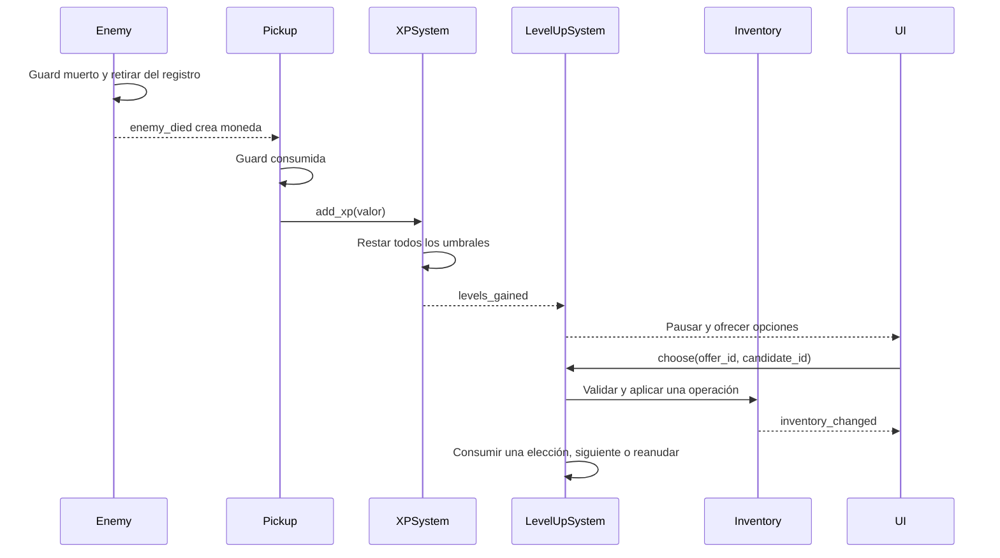

# Contratos públicos entre sistemas

**Versión de contrato: 1 · Dueño: Carlos.** Especificación previa al código. Las firmas son pseudofirmas tipadas, no scripts listos para pegar. Toda modificación requiere actualizar consumidores y casos de aceptación en el mismo PR o una migración compatible.

## Convenciones

Tiempo en segundos (`float` finito), distancia en píxeles (`float`), HP/daño/XP en enteros no negativos, IDs de catálogo en `StringName`, ID de ejecución en `int` monotónico por partida. `run_id` identifica una partida y acompaña eventos globales. Ninguna señal transfiere propiedad de un Node que va a liberarse.

`OpResult = {ok: bool, code: StringName, message: String, value: Variant}`. Códigos: `OK`, `INVALID_ARGUMENT`, `UNKNOWN_ID`, `CAPACITY_REACHED`, `ALREADY_OWNED`, `MAX_LEVEL`, `INVALID_STATE`, `STALE_OFFER`, `EMPTY`, `INVALID_DATA`, `IO_ERROR`. Fallar deja el estado igual. Las consultas no cambian datos. Los getters de inventario/estado devuelven copias de lectura.

## APIs de sistemas

| Sistema / dueño | Entradas y métodos públicos | Salidas / reglas |
|---|---|---|
| GameManager / Carlos | `start_run(config, seed)`, `request_pause()`, `resume()`, `request_menu()`, `queue_terminal(reason)` | OpResult; solo una transición por cierre de frame; `get_run_view()` devuelve run_id/lifecycle/encounter/tiempo |
| DataCatalog / Carlos | `load_and_validate()`, `get_weapon(id)`, `get_passive(id)`, `get_enemy(id)`, `list_items_sorted()` | OpResult o definición opcional; IDs ausentes no crean objetos; carga inválida impide empezar |
| HealthComponent / Guillermo | `apply_damage(amount, source_id)`, `heal(amount)`, `set_max_health(max)` | Daño aplicado/curación efectiva; una muerte; clamps `0..max`; muerto ignora daño/curación |
| Player adaptador / Guillermo | `recibir_dano(amount)`, `ganar_xp(amount)` | Delegan temporalmente a Health/XP sin variables duplicadas |
| InventorySystem / Carlos | `reset()`, `try_add(item_id)`, `try_upgrade(item_id)`, `try_replace(old_id,new_id)`, `snapshot()`, `restore(snapshot)` | OpResult; categorías se resuelven por catálogo; empieza con shotgun L1; replace solo debug/herramienta |
| XPSystem / Carlos | `reset()`, `add_xp(amount)`, `xp_required_for_level(level)`, `get_view()` | OpResult.value contiene niveles ganados; XP sobrante se conserva, máximo20; contador de elecciones ganadas monotónico |
| LevelUpSystem / Carlos | `open_next_offer()`, `choose(offer_id, candidate_id)`, `get_pending_count()` | Oferta inmutable 1–3 opciones o fallback; una confirmación por oferta; elección fallida mantiene oferta |
| StatsResolver / Carlos | `resolve(base_stats, inventory_snapshot, catalog)` | PlayerStats derivados y perfiles por arma; función sin modificar entradas |
| WeaponController / Guillermo | `sync_build(snapshot, resolved_stats)`, `stop_attacks()` | Crea/actualiza/desactiva ejecutores por ID; no modifica inventario; no duplica armas al sincronizar |
| Enemy / René | `configure(definition, enemy_instance_id, run_id)`, `take_damage(amount, source_id)`, `despawn(reason)` | Guard de muerto antes de notificar; despawn administrativo no da XP |
| EnemyRegistry / René | `register(id, enemy)`, `unregister(id)`, `query_targets(origin, radius)` | Lista de TargetView válidos; se limpia antes de usar referencias liberadas |
| EnemySpawner / René | `try_spawn(enemy_id, pattern, run_id)` | OpResult con ID; valida espacio/mapa/cupo; no consume cola por su cuenta |
| WaveManager / René | `start(wave_definition)`, `tick(elapsed_s)`, `stop()`, `get_queue_view()` | Encola en orden; despacha solicitudes; proceso limitado por frame; inicio repetido no duplica eventos |
| SpawnQueue / Javier | `enqueue(event)`, `peek()`, `dequeue()`, `is_empty()`, `size()`, `clear()` | peek/dequeue vacíos devuelven null; FIFO; no decide tiempo ni prioridad |
| ActionHistoryStack / Javier | `push(snapshot)`, `pop()`, `peek()`, `is_empty()`, `clear()` | pop vacío null; copia profunda al registrar estado; política de memoria en blueprint |
| RecursiveTaser / Javier | `chain(start_id, max_targets, query_next, apply_hit)` | Lista ordenada de IDs impactados; visited por descarga, depth limitada; objetivo inválido no crashea |
| Search / Javier | `linear_by_id(items,id)`, `binary_by_id(sorted_items,id)` | Índice o -1; binaria requiere orden ascendente por ID; no usa orden visible traducido |
| Sorting / Javier | `insertion_sort(items,compare)`, `merge_sort(items,compare)` | Nueva lista; comparación distancia, luego ID; devuelve también contadores en modo medición |
| MapGraph / Javier | `load(zones,edges)`, `neighbors(zone_id)` | Grafo validado; sin aristas a IDs inexistentes; listas en orden estable |
| GraphSearch / Javier | `bfs_path(graph,start,goal)`, `dfs_reachable(graph,start)` | BFS ruta inclusiva o []; DFS conjunto/orden visitado; inválidos devuelven resultado explícito |
| WorldState / Carlos | `reset(map_id)`, `set_flag(key,value)`, `visit_zone(id)`, `snapshot()` | Esquema cerrado de claves; eventos al cambiar, no si ya tenía valor |
| MissionSystem / Carlos | `reset(tree)`, `consume_event(event)`, `get_active_missions()` | Activa hijos al completar padre; evento repetido no duplica progreso/recompensa |
| ProfileStore / Carlos | `load_profile()`, `save_profile(profile)`, `append_summary(summary)` | OpResult; versiones/validación/backup; no bloquea jugar si guardado falla |
| HUD/UI / Guillermo | `render(view)`, `show_offer(offer)` | Emite intención de usuario; no contiene fórmula XP ni cálculo de daño |

## EventBus y flujos

Señales propuestas, con tipos conceptuales:

```gdscript
signal run_started(run_id: String)
signal pickup_collected(run_id: String, pickup_id: int, pickup_kind: StringName)
signal zone_entered(run_id: String, zone_id: StringName)
signal enemy_died(run_id: String, enemy_id: int, definition_id: StringName, position: Vector2, xp_reward: int)
signal xp_changed(run_id: String, level: int, current_xp: int, next_required: int)
signal levels_gained(run_id: String, levels: Array[int])
signal inventory_changed(run_id: String, revision: int, snapshot: Dictionary)
signal health_changed(run_id: String, current_hp: int, max_hp: int)
signal player_died(run_id: String)
signal encounter_changed(run_id: String, encounter: int)
signal boss_spawned(run_id: String, enemy_id: int, definition_id: StringName)
signal boss_died(run_id: String, enemy_id: int, definition_id: StringName)
signal run_state_changed(run_id: String, lifecycle: int)
signal world_flag_changed(run_id: String, key: StringName, value: Variant)
signal mission_completed(run_id: String, mission_id: StringName)
signal run_finished(run_id: String, result: StringName, summary: Dictionary)
```

| Hecho | Emisor | Consumidor autorizado | Evitar |
|---|---|---|---|
| enemy_died | Enemy, una vez | PickupSpawner para drop; WorldState/MissionSystem y métricas | Sumar XP directamente y volver a sumarla al recoger |
| xp_changed / levels_gained | XPSystem | HUD / LevelUpSystem | UI modificando el nivel |
| inventory_changed | InventorySystem | GameRun coordina StatsResolver → WeaponController/Health → HUD | Cada arma leyendo/modificando la misma Resource |
| player_died | HealthComponent | GameManager para resolución terminal | Reiniciar escena dentro del callback de colisión |
| boss_spawned / boss_died | EnemySpawner / Enemy | GameManager, WorldState, HUD | Dos sistemas decidiendo victoria |
| mission_completed | MissionSystem | UI/ProfileStore; MissionSystem ordena recompensa a un único servicio | Dos listeners entregando la misma curación |
| run_finished | GameManager | Summary, ProfileStore, métricas | Guardar el mismo resultado desde UI y GameManager |

PickupSpawner pertenece a René y puede ser parte de su servicio de drops, sin un singleton nuevo. `Enemy.take_damage` recibe daño ya calculado; los ataques del enemigo pasan daño bruto a HealthComponent del jugador, que aplica la armadura. No aplicar armadura en ambos extremos.

`run_started` lo emite GameManager una vez tras RUN_INIT; `pickup_collected` lo emite el pickup después de consumo válido y lleva ID único; `zone_entered` lo emite el trigger de zona al cambiar de región. MissionSystem consume estos hechos. WorldState consume zone_entered y muertes de jefes. MissionSystem consulta flags actualizados al activar una misión; el coordinador establece ese orden. No deducir recolección de monedas a partir de puntos XP.

## Flujo completo y orden



GameManager resuelve primero cualquier evento terminal del frame; si lo hay descarta aperturas de menú pendientes. No se emite `inventory_changed` antes de terminar validación. La revisión del inventario aumenta una vez por commit exitoso; una oferta registra la revisión con que fue generada. Si cambia antes de confirmar, se rechaza `STALE_OFFER` y se regenera sin consumir elección.

## Transacción de build y Undo

`choose`: validar lifecycle/oferta → construir snapshot candidato → validar catálogo/capacidad/niveles → preparar snapshot anterior → commit de inventario con snapshot anterior registrado en pila → consumir oferta → publicar cambio confirmado. GameRun recibe el cambio, recalcula stats y sincroniza salud/armas/HUD en ese orden. La implementación agrupa commit/historial y difiere la notificación hasta cerrar la operación para que un fallo de validación no deje entradas en la pila. StatsResolver es una función pura invocada por GameRun, sin otro listener que aplique los efectos por segunda vez. Callbacks solo ven el estado final.

`restore` valida run_id e invariantes, crea nueva revisión (no vuelve a una revisión antigua), recalcula pasivos y sincroniza armas por ID. Undo debug revierte únicamente build, no devuelve la elección consumida ni retrocede XP, HP, enemigos o reloj. Cooldowns se reinician a su periodo completo y HP se limita al nuevo máximo; no se cura por restaurar un pasivo. Se vacía la pila en nueva partida. La UI explica el alcance.

## Propiedad de archivos y dobles de prueba

| Persona | Puede crear/editar como owner | Requiere revisión del owner ajeno |
|---|---|---|
| Carlos | core, data/schema, systems, arquitectura/contratos | project.godot, player, armas visuales |
| Guillermo | escenas/UI, player, combat, project.godot | waves, algoritmos, Inventory/XP |
| René | waves, Enemy, pickups, escenas de enemigos/jefes | Player, core, algoritmos |
| Javier | algorithms, pruebas de estructuras y benchmarks | escenas, estados de gameplay |
| Roberto | datos de contenido, docs, casos/fixtures y registros de prueba | esquemas, servicios de runtime |

Antes de integrar, preparar FakeEnemy con ID/posición/HP; FakeCatalog con tres armas y tres pasivos; FakeClock controlable; UI de botones sin arte; eventos de oleada pequeños. Son herramientas de desarrollo, no sistemas alternativos de producción.
