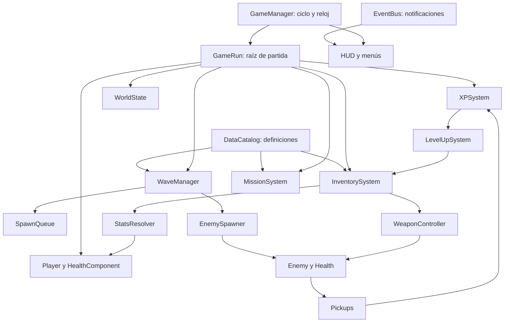

# Arquitectura general del proyecto

**Dueño: Carlos · Revisores: Guillermo y responsables de cada consumidor.** Se propone composición simple en Godot 4: nodos para comportamiento, recursos para catálogos y estructuras puras para algoritmos. La arquitectura conserva las escenas existentes y añade servicios con un único dueño del dato.

## Estructura objetivo incremental

```text
project.godot + escenas/arte existentes en raíz [conservar hasta CP2]
scripts/
  core/       game_manager.gd, event_bus.gd, run_state.gd
  data/       data_catalog.gd, weapon_definition.gd, passive_definition.gd,
              enemy_definition.gd, wave_definition.gd, mission_definition.gd
  systems/    inventory_system.gd, xp_system.gd, level_up_system.gd,
              stats_resolver.gd, world_state.gd, mission_system.gd, profile_store.gd
  waves/      wave_manager.gd, enemy_spawner.gd, enemy_registry.gd
  algorithms/ spawn_queue.gd, action_history_stack.gd, recursive_taser.gd,
              sorting.gd, search.gd, map_graph.gd, graph_search.gd
  combat/     weapon_controller.gd, health_component.gd, taser.gd, machete.gd
  ui/         hud_controller.gd, level_up_controller.gd, debug_panel.gd
scenes/       ui/, maps/, tests/ [solo escenas nuevas]
data/         weapons/, passives/, enemies/, waves/, maps/, missions/
tests/        algorithms/, systems/, integration/, performance/
docs/         documentos, roles/, checkpoints/, evidence/, metrics/
academic_reference/checkpoint1/ [Python de referencia, no runtime]
```

Estas son rutas previstas, no archivos que ya existan. No crear scripts vacíos para completar el árbol.

## Composición de una partida



**Autoloads propuestos:** EventBus y DataCatalog. GameManager vive en la escena raíz persistente; cada GameRun es hijo nuevo al iniciar. ProfileStore puede ser hijo de la raíz, sin necesitar otro autoload. No se hace un singleton por algoritmo. DataCatalog carga/valida una vez y no guarda niveles o vida.

```text
AppRoot [GameManager, procesa siempre]
├── ProfileStore
├── GameRun [existe durante una partida]
│   ├── Colonia / ZoneTriggers
│   ├── Player / HealthComponent / WeaponController
│   ├── Enemies / Projectiles / Pickups
│   ├── XPSystem / InventorySystem / LevelUpSystem
│   ├── WaveManager / EnemyRegistry
│   └── WorldState / MissionSystem
└── UILayer [procesa siempre]
    ├── MainMenu / HUD / LevelUpMenu / PauseMenu / Summary
    └── DebugPanel [solo desarrollo]
```

GameManager monta nodos, inyecta referencias y conecta señales. No calcula daño, elige enemigos ni define tablas de balance. Las señales informan hechos ya confirmados; métodos directos representan órdenes que pueden fallar. Ver [contratos](INTERFACES.md).

## Máquina de estados

Dos ejes evitan un estado combinado por cada pausa de cada jefe:

- `lifecycle`: BOOT, MENU, RUN_INIT, RUNNING, LEVEL_UP, PAUSED, VICTORY, DEFEAT, SUMMARY.
- `encounter`: NORMAL, MINI_BOSS, FINAL_BOSS. Solo informa qué encuentro sigue activo; no gobierna la pausa.

| Origen | Evento | Destino | Acción |
|---|---|---|---|
| BOOT | Catálogo válido | MENU | Si inválido, pantalla de error con detalle y sin iniciar partida |
| MENU/SUMMARY | Jugar | RUN_INIT | Despausar árbol, destruir run previo, crear run_id, inicializar datos |
| RUN_INIT | Sistemas listos | RUNNING | Escopeta L1, reloj cero, cola cargada, HUD sincronizado |
| RUNNING | Elecciones pendientes | LEVEL_UP | Pausar mundo, abrir oferta válida |
| LEVEL_UP | Elección confirmada | LEVEL_UP o RUNNING | Otra oferta si quedan pendientes; reanudar si se agotaron |
| RUNNING | Esc | PAUSED | Congelar mundo y reloj |
| PAUSED | Esc/Reanudar | RUNNING | Mantener encounter y tiempos |
| RUNNING | Terminal al resolver frame | DEFEAT o VICTORY | Muerte tiene prioridad; desactivar daño/spawns; limpiar elecciones |
| DEFEAT/VICTORY | Resumen listo | SUMMARY | Guardar resultado una vez |
| LEVEL_UP/PAUSED/SUMMARY | Volver al menú | MENU | Liberar run, conexiones y registros; despausar árbol |

Esc durante LEVEL_UP no descarta la elección ni reanuda; el usuario puede volver al menú mediante botón. Muerte/CIO/XP del mismo frame se acumulan y GameManager resuelve una sola transición terminal antes de abrir mejoras. La simulación solo avanza en RUNNING; overlays siguen recibiendo input. El manejo de pausa sigue [process mode de Godot](https://docs.godotengine.org/en/stable/tutorials/scripting/pausing_games.html).

`elapsed_s` mide tiempo activo total; `survival_s=min(elapsed_s,300)` es una vista; `boss_elapsed_s` se deriva del instante de spawn correcto del CIO. Nadie mantiene otro cronómetro de autoridad.

## Autoridad de estado

| Dato | Único escritor | Lectores |
|---|---|---|
| HP y muerte jugador | HealthComponent | HUD, GameManager |
| Nivel, XP y elecciones ganadas | XPSystem | LevelUpSystem, HUD |
| Elecciones consumidas/oferta activa | LevelUpSystem | UI, GameManager |
| Armas/pasivos y niveles | InventorySystem | StatsResolver, WeaponController, UI |
| Stats calculados | StatsResolver | Player, armas, HealthComponent |
| Reloj, lifecycle, encounter y resultado | GameManager | Waves, HUD, métricas |
| Eventos pendientes | WaveManager mediante SpawnQueue | Debug, spawner |
| Enemigos activos | EnemyRegistry | Targeting, Taser, métricas |
| Flags de zonas/jefes | WorldState | Misiones, mapa, UI |
| Progreso de misiones | MissionSystem | UI, ProfileStore |
| Catálogos | DataCatalog al cargar | Todos los consumidores |

WorldState no duplica `player_level`, inventario o HP; los paneles consultan sus dueños. Evita la copia de nivel que sugería v1.

## Colisiones propuestas

| Capa | Bitmask | Entidades | Detecta |
|---|---:|---|---|
| 1 world | 1 | Paredes y límites | N/A |
| 2 player | 2 | Player | world + enemy = 5 |
| 3 enemy | 4 | Enemigos | world + player = 3 |
| 4 player_attack | 8 | Bala, área Machete | enemy = 4 |
| 5 pickup | 16 | Monedas/Regia | player = 2 |
| 6 enemy_attack | 32 | Ataques CIO | player = 2 |

Los enemigos no bloquean físicamente a otros enemigos en la propuesta inicial; si se añade separación se mide su coste. Estas máscaras sustituyen defaults en un ticket de Guillermo, con prueba de cada contacto. Son una propuesta y no reflejan configuración ya aplicada.

## Límites de acoplamiento

UI no toca arrays ni vida: llama métodos y recibe snapshots de lectura. Enemy no busca el nodo HUD. WaveManager no modifica el inventario. Algoritmos reciben IDs/datos o funciones de consulta, no NodePaths de la escena. El GameRun conecta eventos a consumidores explícitos; EventBus no almacena referencias de escenas destruidas.

Al reiniciar: marcar run antiguo inactivo, desconectar, parar timers, liberar entidades, limpiar registros/colas/pilas, despausar y crear estado nuevo. Eventos con otro run_id se ignoran. Probar tres reinicios seguidos para detectar duplicados.

## Migración y prueba de arquitectura

Aplicar [baseline](BASELINE_GODOT.md) por adaptadores. Primero probar Enemy/XP/UI con eventos sintéticos; después con muerte y pickup reales. Un PR que mueve una escena debe comprobar todas sus referencias `.tscn`, `preload` y `.uid`. Arquitectura aceptada cuando un cambio de daño requiere editar datos, añadir un enemigo reutiliza su ciclo y reiniciar no conserva estado de la partida anterior.
