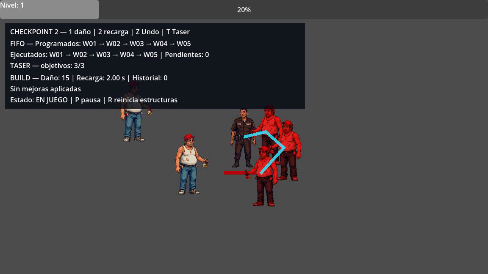

# Evidencia reproducible — Checkpoint 2

Ejecutado por René Serrano con apoyo de Codex el 11 de octubre de 2026.

- Base revisada: `origin/main` en `3e5e55a824247d99d15aea85cd6643441ab66e98`.
- Rama de trabajo: `checkpoint2/rene-2026-10-11`.
- Motor: Godot `4.7.2.stable.official.ed1daf0bf`.
- Renderer visual: OpenGL 3.3 Compatibility, 1152 × 648.
- SHA validado y demostrado: `5a58b3df68b80817463006067c00168945aeeebd`.
- SHA de entrega en `main`: `e88759d32962891d30fd9b7b890f628424ee057c` (merge de PR #15).

## Resultados

| Verificación | Resultado |
|---|---:|
| Importación headless | Exit 0 |
| Runner original Queue/Stack | 25/25 pasan |
| Runner integrado Checkpoint 2 | 17/17 pasan |
| Smoke test de escena principal | Exit 0 |
| Render de 180 frames / 6 segundos | Exit 0, sin errores de gameplay |

El runner integrado verificó:

- W01–W05 salen de la cola en orden FIFO y generan cinco escenas de enemigo reales.
- La cola vacía devuelve un resultado vacío sin fallar.
- Las mejoras cambian el daño y la recarga reales de la escopeta.
- `peek` consulta el snapshot y dos `pop` restauran el build en orden LIFO.
- Undo con historial vacío no falla.
- El Taser cubre 0, 1 y 3 objetivos, aplica daño real y no repite nodos visitados.

## Comandos

```powershell
godot --headless --editor --path . --quit
godot --headless --path . --script tests/algorithms/test_runner.gd
godot --headless --path . --script tests/checkpoint2/test_runner_checkpoint2.gd
godot --headless --path . --quit-after 360
```

## Evidencia visual



La captura muestra W01–W05 ya ejecutados en orden, cero eventos pendientes y una cadena visible de Taser sobre tres objetivos. El build está en su estado inicial; las teclas `1`, `2` y `Z` permiten demostrar los dos cambios y Undo durante la misma partida.

## Ruido de entorno no funcional

En el sandbox de pruebas, Godot no pudo escribir `user://logs` ni `editor_settings-4.7.tres`, y reportó que no pudo leer el almacén raíz de certificados. Estos mensajes pertenecen a permisos del entorno de automatización: no cambiaron los códigos de salida, no produjeron errores de scripts/escenas y el render real finalizó correctamente.

## Revalidación de Javier — J06/J07

Ejecutada el 11 de octubre de 2026 con Godot `4.7.2.stable.official.ed1daf0bf` sobre el SHA `fa5bb90d0b3c8e17888091520480ff155e5f447a`:

| Verificación | Resultado |
|---|---:|
| Importación headless | Exit 0 |
| Runner original Queue/Stack | 25/25 pasan |
| Runner C02 | 2/2 pasan |
| Runner integrado Checkpoint 2 | 22/22 pasan |

La ampliación cubre 8 objetivos, límite duro de 8, límite cero y corte por distancia, además de los casos 0/1/3 ya registrados.
